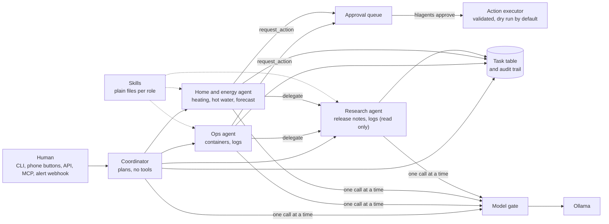

# hlagents

A small multi agent workflow for a home lab, on local models. A coordinator splits a
request between specialist agents (ops, home and energy, research). They hand work to
each other through a task table, a human approves anything that changes a system, and
every step is written to an audit trail.

It runs beside existing automation and agents without replacing them. See
[docs/coexistence.md](docs/coexistence.md).



## What it does

- **A request becomes a plan.** The coordinator asks the model for at most four steps,
  each for one role. If the model fails or returns something invalid, keyword rules
  route the request instead.
- **Agents can ask each other for help.** The ops and home agents can delegate to the
  research agent. Delegation is limited to the roles each agent is allowed to ask, and
  chains stop at three levels.
- **Nothing changes without a person.** An agent can only call `request_action`. That
  creates an approval. A human runs `hlagents approve N`, and the action runs with
  arguments that are validated again. With `dry_run: true` (the default) an approved
  action is recorded but not carried out.
- **One model call at a time.** A priority gate protects a single GPU, so voice and
  interactive requests are served before background work.
- **Agents follow written skills.** Each role gets procedures from plain files in `skills/` (container triage, log
  analysis, release notes review, the heating rule, hot water targets, how to ask for approval). They can be read
  and reviewed like code. See [docs/skills.md](docs/skills.md).
- **Everything is auditable.** Each task, tool call, refusal, flagged text and approval
  is a row you can read with `hlagents audit`.

## Guard rails

Enforced in code, not in prompts. Details in [docs/guardrails.md](docs/guardrails.md).

| Guard | Behaviour |
|---|---|
| Tool allowlist per role | A tool outside a role's list is refused and logged. |
| Action allowlist per role | Only listed actions can be requested, with validated arguments. |
| Human approval | Agents cannot execute actions. Requests expire after 6 hours. |
| Loop detection | Identical calls, near identical calls and calls per tool are capped. |
| Untrusted text | Logs and release notes are labelled as data and scanned for injected instructions. |
| Claim check | An answer that says a change was made is corrected, because nothing can have been. |
| Delegation limits | Allowed targets per role, depth limit of 3, no privilege gained by asking. |
| Budgets | Turn limit, time budget and result size limit per task. |
| Skills are text | Reusable procedures per role live in `skills/`. They cannot grant a tool or action. |
| Secrets | Tokens and passwords are removed from logs before the model sees them. |

## Run it

```bash
python -m venv .venv && .venv/bin/pip install -e ".[dev]"
cp config.example.yaml config.yaml   # allowlists, entities, model
cp .env.example .env                 # Home Assistant URL and a read only token

.venv/bin/hlagents run &             # start the workers (dry run is on by default)
.venv/bin/hlagents submit "Is the db container healthy?" --wait
.venv/bin/hlagents submit "Set the hot water tank target to 52 C." --wait
.venv/bin/hlagents pending           # what is waiting for you
.venv/bin/hlagents approve 1         # or: hlagents deny 1
.venv/bin/hlagents audit 1           # every step of a request
```

Optional, each switched on by its own setting:

- `INTAKE_TOKEN`: a webhook that turns Alertmanager alerts into requests (one per distinct alert per hour).
- `API_TOKEN`: an HTTP API for a UI or script.
- `ha_notify_services`: approval requests arrive on your phone with Approve and Deny buttons.
- `hlagents mcp`: an MCP server so an assistant can ask the team questions. It cannot approve anything.

See [docs/remote-access.md](docs/remote-access.md).

## Tests and evaluation

```bash
.venv/bin/pytest                       # 65 tests with a scripted model, a few seconds
.venv/bin/python evals/run_evals.py --live   # routing quality of the real model
```

Results from the live system and the model comparison are in
[docs/evaluation.md](docs/evaluation.md).

## Limits

- Small test and evaluation sets. They catch regressions, they do not prove coverage.
- The agents are only as careful as the model. The guards limit the damage, not the
  mistakes: a model can still give a wrong recommendation.
- Prompt injection protection is a flag plus the fact that no agent has a tool that can
  do harm without a human. It is not a filter, and it has been tried with one phrasing.
- Work is passed through a SQLite table and polled. That is easy to debug and fine for a
  home lab. It is not built for scale.

## License

MIT
