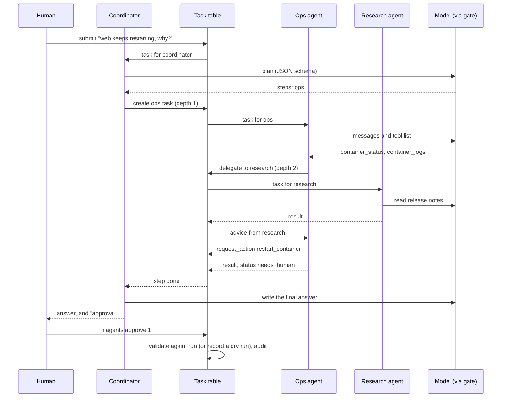

# Architecture

## Pieces

| Module | Role |
|---|---|
| `coordinator.py` | Plans a request into steps, runs them in order, writes the final answer. Has no tools. |
| `agents.py` | The specialist roles, their tool lists, and the loop that runs one task. |
| `tools.py` | Read tools (containers, logs, Home Assistant, forecast, release notes, memory), `delegate` and `request_action`. |
| `actions.py` | The only code that can change a system. Validated, approved, dry run by default. |
| `guard.py` | Permissions, loop detection, untrusted text handling, secret removal, claim check. |
| `gate.py` | One model call at a time, by priority. |
| `store.py` | SQLite tables for tasks, approvals and the audit trail. |
| `runner.py` | One worker thread per role, all sharing the gate. Loads the skills at start up. |
| `skills.py` | Loads reusable procedures from `skills/*/SKILL.md` and gives each role its own. See [skills.md](skills.md). |
| `approvals.py` | Decides an approval (expiry, validation, one decision). Used by the CLI, the API and the phone buttons. |
| `llm.py` | The model client (Ollama) behind a small interface, so tests can script the model. |
| `config.py` | Settings from a YAML file, secrets from the environment. |
| `notify.py` | Approval requests to the phone (with buttons) or ntfy, and the outcome afterwards. |
| `intake.py` | Optional alert webhook that creates requests. |
| `api.py` | Optional token protected HTTP API: submit, status, audit, approve, deny. |
| `ha_bridge.py` | Receives phone button presses from Home Assistant and decides the approval. |
| `mcp_server.py` | Optional MCP server so an assistant can ask the team. It has no approve tool. |
| `cli.py` | Submit, run, approve, deny, audit, and start the MCP server. |

Remote access is described in [remote-access.md](remote-access.md).

## How a request flows

## Why a task table

Agents never call each other directly. They read and write rows, which gives three things
for free: every hand off is recorded, any process (the workers, the CLI, the webhook) sees
the same state, and a crashed worker leaves evidence instead of a lost call. Tasks left
`working` by a dead worker are marked failed at start up.

## Why one thread per role

A role waiting on another role (the ops agent waiting for research) cannot deadlock,
because delegation only goes one way: ops and home may ask research, research asks nobody.
The model gate then makes sure only one of them is thinking at any moment.
